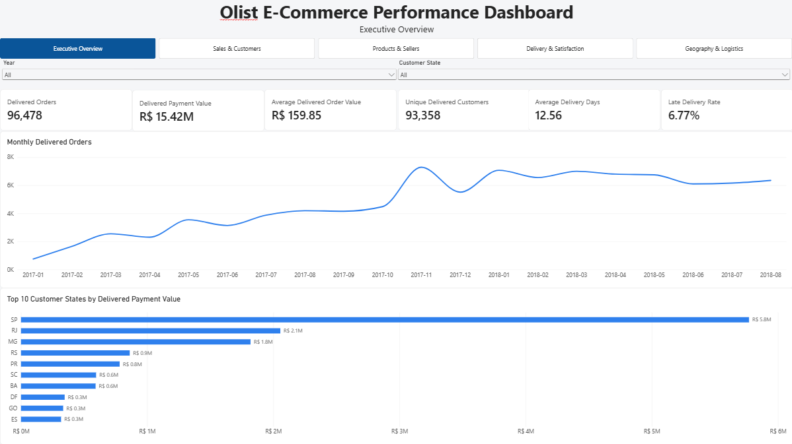

# Olist E-Commerce Analytics

## Project Overview

This project presents an end-to-end analysis of the Brazilian Olist e-commerce marketplace, with the goal of understanding sales growth, customer purchasing behavior, product and seller performance, delivery efficiency, geographic logistics, and the factors associated with customer satisfaction. The analysis covers 99,441 orders and integrates information across customers, products, sellers, payments, reviews, order items, and geolocation data.

The project was built as a complete analytics workflow rather than a standalone dashboard. Python was used for data profiling, cleaning, validation, and transformation; DuckDB and SQL were used to construct reproducible business analyses across multiple data grains; and Power BI was used to develop an interactive five-page dashboard for exploring commercial and operational performance. Particular attention was given to relational modeling, grain control, analytical validation, and translating technical results into actionable business findings.

## Project Files

- [Power BI Dashboard](dashboard/olist_dashboard.pbix) — Download the interactive five-page Power BI report.
- [Business Report (PDF)](reports/olist_business_report.pdf) — Read the complete business analysis, findings, and recommendations.
- [Business Report (DOCX)](reports/olist_business_report.docx) — Editable version of the final report.

## Business Questions

The analysis was structured around six core business questions:

1. How did order volume, payment value, and average order value evolve over time?
2. How important are repeat customers to marketplace performance, and how does their purchasing behavior differ from one-time customers?
3. Which product categories and sellers contribute most strongly to marketplace sales?
4. How is delivery performance associated with customer satisfaction and review outcomes?
5. How do geography and interstate fulfillment affect delivery time, freight cost, and late-delivery risk?
6. Are multi-seller orders associated with weaker customer experience even after accounting for obvious operational factors such as lateness?

## Data & Analytical Approach

The analysis uses the public Brazilian Olist e-commerce dataset, originally provided as nine relational CSV files covering orders, customers, order items, payments, reviews, products, sellers, product-category translations, and geolocation. The raw data was first profiled and cleaned in Python, including datetime validation, duplicate handling, missing-value assessment, review and payment consolidation, product-category standardization, and geolocation aggregation. Cleaned datasets were then transformed into analytics-ready fact and dimension tables, including an order-level fact table with 99,441 orders and an order-item fact table with 112,650 line items.

A relational analytical model was deliberately maintained instead of flattening all sources into a single table. Order-level metrics such as delivery performance, review outcomes, and payment value were analyzed at the order grain, while product-, category-, and seller-level metrics were calculated from the order-item grain. This separation was important for preventing duplicated values when working across one-to-many relationships. Additional derived tables were created where a more controlled analytical population was required, such as the single-seller order table used for interstate fulfillment comparisons.

DuckDB was used as the analytical database and SQL engine for the main business analysis. Reusable SQL scripts were developed for executive performance, sales trends, product categories, customers, delivery operations, sellers, payments, geography, and statistical validation. The resulting analytical model was then imported into Power BI, where shared customer, product, seller, date, and geography dimensions were used to connect the fact tables while avoiding ambiguous fact-to-fact relationships.

## Interactive Dashboard

The final Power BI report contains five analytical pages: **Executive Overview**, **Sales & Customers**, **Products & Sellers**, **Delivery & Satisfaction**, and **Geography & Logistics**. The pages are connected through synchronized Year and Customer State slicers and a shared navigation bar, allowing users to move between commercial, customer, operational, and geographic views while preserving the selected analytical context.

The dashboard was designed to separate high-level business monitoring from deeper diagnostic analysis. The Executive Overview summarizes marketplace performance through core KPIs and trends, while the remaining pages examine sales growth and customer behavior, category and seller performance, delivery-related satisfaction, and geographic fulfillment efficiency.



## Key Findings

### 1. Marketplace growth was driven primarily by transaction volume

Delivered orders grew rapidly through 2017 and remained substantially higher in 2018, while average delivered order value stayed comparatively stable. During January–August 2018, year-over-year delivered-order growth ranged from approximately **+51% to +843%**, while delivered payment-value growth ranged from approximately **+53% to +746%**. This indicates that marketplace expansion was driven mainly by higher transaction volume rather than sustained increases in customer spending per order.

### 2. Customer retention was very low, but repeat customers were commercially valuable

Among customers with delivered orders, **90,557 were one-time customers and 2,801 were repeat customers**, meaning only about **3.0%** placed multiple delivered orders during the observed period. Repeat customers nevertheless generated approximately **R$308.59 in observed delivered payment value per customer**, compared with **R$160.76** for one-time customers, or roughly **1.9 times more**.

### 3. Delivery lateness was strongly associated with customer dissatisfaction

The negative-review rate increased from **9.22% for early deliveries** and **12.42% for orders delivered on the promised date** to **62.42% for late deliveries**. The deterioration became particularly severe once delays exceeded three days: orders delivered **4–7 days late had a 67.68% negative-review rate**, while delays of **8–14 days reached 80.15%**. These results identify severe delivery delays as one of the clearest operational indicators associated with poor customer experience.

### 4. Interstate fulfillment carried a substantial logistics penalty

Among delivered single-seller orders, interstate fulfillment was associated with an average delivery time of **15.21 days**, compared with **7.97 days** for same-state orders. Interstate orders also had higher average freight costs (**R$26.55 vs R$15.19**) and a higher late-delivery rate (**8.14% vs 4.56%**). Relative to same-state fulfillment, interstate orders therefore experienced approximately **90.90% longer delivery times, 74.87% higher freight costs, and 78.59% higher late-delivery rates**.

### 5. Multi-seller orders showed substantially weaker satisfaction outcomes

Even after restricting the comparison to delivered, non-late, multi-item orders, multi-seller orders had a **46.92% negative-review rate**, compared with **21.01% for single-seller orders**. Average review score also fell from **3.85 for single-seller orders to 2.87 for multi-seller orders**. This suggests that fulfillment complexity may be associated with weaker customer experience beyond delivery lateness alone.

### 6. Sales were concentrated, but not dependent on only a handful of sellers or categories

The marketplace contained **2,970 active sellers**, of which **533 sellers generated approximately 80% of delivered item sales**, equivalent to **17.95% of active sellers**. Similarly, **18 of 74 active product categories** accounted for approximately **80% of category-level sales**. The concentration is meaningful, but sufficiently distributed that overall marketplace performance was not dependent on only a very small number of sellers or categories.

## Business Recommendations

1. **Prioritize prevention of severe delivery delays.** Customer dissatisfaction increased sharply as delays became longer, particularly once orders exceeded three days late. Operational monitoring should therefore focus on identifying shipments at risk of entering the 4+ day delay range, where negative-review rates rose substantially.

2. **Strengthen repeat-customer development.** Repeat purchasing was rare, despite repeat customers generating substantially higher observed payment value per customer. The marketplace should evaluate targeted retention initiatives such as post-purchase remarketing, loyalty incentives, and personalized repeat-purchase campaigns for first-time buyers.

3. **Investigate the multi-seller customer journey.** Multi-seller orders were associated with considerably weaker review outcomes even after restricting the comparison to non-late, multi-item orders. Further investigation should focus on split deliveries, shipment coordination, communication, and order-status transparency to determine which aspects of multi-seller fulfillment contribute most strongly to customer dissatisfaction.

4. **Use seller performance scorecards that combine commercial and service metrics.** Seller evaluation should consider not only sales contribution but also late-delivery rate, review score, and negative-review rate. This would allow commercially important sellers with weak service outcomes to be identified and prioritized for operational review.

5. **Evaluate regional supply and logistics imbalances.** Seller activity was more geographically concentrated than customer demand, while interstate fulfillment was associated with materially longer delivery times, higher freight costs, and greater late-delivery risk. Regional seller recruitment, fulfillment partnerships, or alternative inventory-positioning strategies should be evaluated in areas where demand is strong but local supply is comparatively limited.

6. **Monitor seller and category concentration over time.** Although sales were concentrated, performance was not dependent on only a very small number of sellers or categories. Concentration should therefore be monitored as a strategic risk indicator while preserving marketplace diversity and avoiding excessive dependence on the largest contributors.

## Technical Architecture & Tools

The project was built as a layered analytics workflow, progressing from raw source files to cleaned datasets, analytics-ready relational tables, SQL analysis, and an interactive Power BI reporting layer. Python was used for data profiling, cleaning, validation, feature engineering, and table construction; DuckDB provided the analytical database layer; SQL was used for business analysis and validation; and Power BI was used for dimensional modeling, DAX measures, interactive filtering, and dashboard development.

The main tools and skills demonstrated in the project include:

- **Python:** pandas, NumPy, data cleaning, validation, transformation, and feature engineering
- **SQL:** joins, aggregations, CTEs, window functions, conditional logic, segmentation, ranking, and analytical validation
- **DuckDB:** local analytical database construction and reproducible SQL execution
- **Power BI:** dimensional modeling, DAX measures, calculated tables and columns, slicer synchronization, interaction control, tooltips, and dashboard design
- **Data Modeling:** fact and dimension tables, grain management, one-to-many relationships, and avoidance of ambiguous fact-to-fact joins
- **Statistical Analysis:** correlations, controlled comparisons, distribution-based validation, and interpretation of observational relationships
- **Git / GitHub:** project organization, version control, documentation, and portfolio publishing

### Analytics Workflow

```text
Raw CSV Files
      ↓
Python Profiling & Cleaning
      ↓
Processed Parquet Files
      ↓
Analytics Fact & Dimension Tables
      ↓
DuckDB + SQL Analysis
      ↓
Power BI Data Model + DAX
      ↓
Interactive Business Dashboard
```

## Repository Structure

```text
olist-ecommerce-analysis/
│
├── data/
│   ├── raw/                     # Original Olist CSV files
│   ├── processed/               # Cleaned and standardized Parquet files
│   └── analytics/               # Analytics-ready fact/dimension tables and DuckDB database
│
├── notebooks/
│   └── 01_data_profiling.ipynb  # Initial data profiling and exploratory validation
│
├── src/
│   ├── clean_data.py             # Data cleaning and standardization pipeline
│   ├── build_analytics_tables.py # Builds fact and dimension tables
│   ├── build_duckdb.py           # Creates and validates the DuckDB analytical database
│   ├── sql_basics.py             # SQL learning and validation work
│   └── run_analysis_sql.py       # Executes the business-analysis SQL scripts
│
├── sql/
│   ├── 01_executive_overview.sql
│   ├── 02_sales_trends.sql
│   ├── 03_product_category_analysis.sql
│   ├── 04_customer_analysis.sql
│   ├── 05_delivery_operations.sql
│   ├── 06_seller_analysis.sql
│   ├── 07_payment_analysis.sql
│   ├── 08_geography_analysis.sql
│   └── 09_statistical_validation.sql
│
├── dashboard/
│   └── olist_dashboard.pbix     # Five-page interactive Power BI dashboard
│
├── reports/                     # Final business report and supporting documentation
├── images/                      # Dashboard screenshots and portfolio visuals
├── README.md                    # Main project documentation
└── .gitignore
```
## Limitations

Several limitations should be considered when interpreting the results. First, the analysis is observational and therefore identifies associations rather than causal relationships. For example, late deliveries and multi-seller orders are associated with weaker review outcomes, but the dataset does not prove that these factors alone caused customer dissatisfaction.

Customer retention should also be interpreted within the available observation window. A customer classified as one-time may have purchased again outside the dataset period, so the reported repeat-customer rate represents observed repeat behavior rather than a complete lifetime retention measure.

Geographic logistics comparisons were restricted where necessary to improve attribution quality. In particular, interstate fulfillment analysis focused on delivered single-seller orders so that seller state could be assigned unambiguously to each order. These results therefore should not be interpreted as representing every order in the marketplace.

Review-based metrics are calculated only for orders with available review scores, and seller-quality comparisons may still be influenced by differences in product mix, geography, customer characteristics, or other operational factors not fully controlled in the dataset.

Finally, the dataset does not contain information on profit margins, marketing costs, inventory availability, warehouse capacity, carrier contracts, or customer acquisition costs. Recommendations involving retention campaigns, regional fulfillment expansion, or seller interventions should therefore be treated as areas for business evaluation rather than directly validated financial decisions.

## How to Run the Project

### 1. Clone the repository

```bash
git clone https://github.com/mu-kaplan/olist-ecommerce-analysis.git
cd olist-ecommerce-analysis
```

### 2. Create and activate a Python environment

```bash
python -m venv .venv
```

On Windows PowerShell:

```powershell
.venv\Scripts\Activate.ps1
```

### 3. Install the required Python packages

```bash
pip install -r requirements.txt
```

### 4. Add the source data

Download the public Brazilian Olist e-commerce dataset and place the original CSV files inside:

```text
data/raw/
```

The expected source files cover customers, geolocation, order items, payments, reviews, orders, products, sellers, and product-category translations.

### 5. Run the data pipeline

Execute the scripts from the project root in the following order:

```bash
python src/clean_data.py
python src/build_analytics_tables.py
python src/build_duckdb.py
```

These steps clean and validate the raw data, create the processed Parquet files, build the analytics-ready fact and dimension tables, and construct the local DuckDB analytical database.

### 6. Run the SQL analysis

```bash
python src/run_analysis_sql.py
```

The script executes the business-analysis queries stored in the `sql/` directory against the analytical DuckDB database.

### 7. Open the Power BI dashboard

Open:

```text
dashboard/olist_dashboard.pbix
```

in Power BI Desktop to explore the interactive dashboard.

The Power BI report uses the analytics-ready Parquet files generated by the Python pipeline. If the repository is moved to a different local directory, Power BI data-source paths may need to be updated before refreshing the report.

## Data Source

This project uses the public **[Brazilian E-Commerce Public Dataset by Olist](https://www.kaggle.com/datasets/olistbr/brazilian-ecommerce)**, which contains anonymized marketplace data covering orders, customers, sellers, products, payments, reviews, order items, and geolocation.

The dataset is publicly available through Kaggle and was used strictly for educational and portfolio purposes.

## Project Purpose

This project was developed as a portfolio case study to demonstrate practical skills in data cleaning, relational modeling, SQL analysis, business intelligence, dashboard development, and the translation of analytical results into defensible business recommendations.


