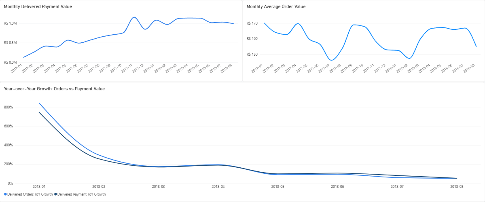
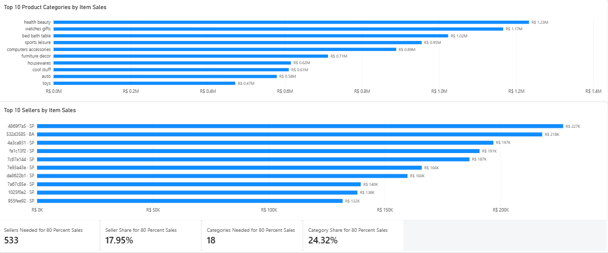
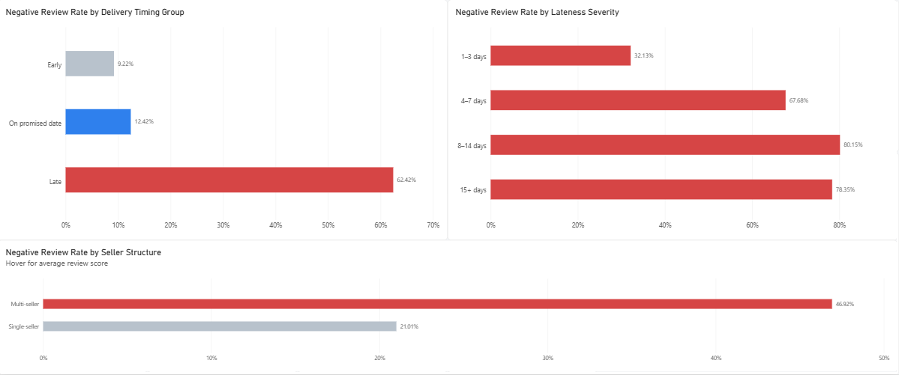
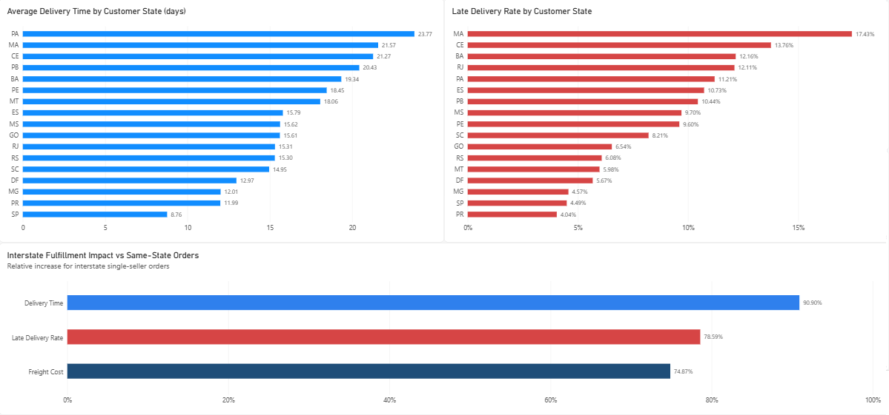

# Olist E-Commerce Marketplace Analysis

**End-to-End Business Analytics Case Study**

Python · SQL · DuckDB · Power BI

Prepared as a portfolio project

---

## Executive Summary

This report presents an end-to-end analysis of the Brazilian Olist e-commerce marketplace, integrating order, customer, product, seller, payment, review, and geographic data to evaluate commercial performance and operational efficiency. The analysis covers 99,441 orders and was developed using Python for data preparation and validation, DuckDB and SQL for analytical processing, and Power BI for interactive business intelligence. Particular attention was given to maintaining the correct analytical grain across order- and item-level data so that payment, delivery, seller, product, and review metrics could be interpreted without duplication.

The results indicate that marketplace growth was driven primarily by rising transaction volume rather than sustained increases in average order value. Customer retention was comparatively weak, with only about 3% of delivered customers placing multiple delivered orders during the observed period, although repeat customers generated approximately 1.9 times more observed payment value per customer than one-time customers. Operational performance was strongly associated with customer satisfaction: the negative-review rate increased from 9.22% for early deliveries to 62.42% for late deliveries, and exceeded 67% once delays reached four days or more. Multi-seller orders also showed substantially weaker review outcomes than comparable single-seller orders, suggesting that fulfillment complexity may represent an additional customer-experience challenge.

Geographic analysis identified a further operational constraint. Seller activity was substantially more concentrated geographically than customer demand, and interstate single-seller orders experienced approximately 90.90% longer delivery times, 74.87% higher freight costs, and 78.59% higher late-delivery rates than same-state orders. Based on these findings, the main business priorities are to reduce severe delivery delays, strengthen repeat-customer development, investigate the multi-seller fulfillment experience, integrate service-quality measures into seller performance management, and evaluate regional supply and fulfillment imbalances. These recommendations should be treated as evidence-based areas for intervention and further testing rather than causal or financial conclusions, since the dataset does not include variables such as profitability, marketing cost, inventory availability, or fulfillment-network capacity.

## 1. Business Context and Objectives

Olist operated as a Brazilian e-commerce marketplace connecting customers with a geographically distributed network of sellers. This structure creates a combination of commercial and operational challenges: growth depends on generating sufficient transaction volume and repeat purchasing, while customer experience is influenced by seller performance, delivery execution, freight conditions, and the complexity of marketplace fulfillment.

The objective of this analysis was to evaluate marketplace performance from both a commercial and operational perspective and to identify patterns that could support business decision-making. Rather than focusing only on revenue or order volume, the project examined how customer behavior, seller structure, product performance, delivery outcomes, and geography interact across the marketplace.

The analysis was organized around six core business questions:

1. How did order volume, delivered payment value, and average order value evolve over time?
2. How important were repeat customers to marketplace performance, and how did their purchasing behavior differ from that of one-time customers?
3. Which product categories and sellers contributed most strongly to marketplace sales?
4. How was delivery performance associated with review outcomes and customer satisfaction?
5. How did geographic structure and interstate fulfillment affect delivery time, freight cost, and late-delivery risk?
6. Were multi-seller orders associated with weaker customer experience after controlling for obvious operational factors such as delivery lateness?

The broader goal was to move beyond descriptive reporting and identify commercially meaningful areas for operational improvement. The analysis therefore emphasized not only what happened in the marketplace, but also where performance differences were large enough to justify further investigation or intervention.

## 2. Data and Methodology

### 2.1 Data Sources and Preparation

The analysis used the public Brazilian Olist e-commerce dataset, provided as nine relational CSV files covering orders, customers, order items, payments, reviews, products, sellers, product-category translations, and geolocation. The raw files were first profiled in Python to assess structure, missing values, duplicates, data types, timestamp consistency, and relational coverage.

Data cleaning included datetime conversion and chronology checks, duplicate handling, normalization of blank and missing values, consolidation of payment and review records to the order level, standardization of product categories, and aggregation of geolocation records to a ZIP-prefix level. The cleaned datasets were stored as Parquet files and then transformed into analytics-ready fact and dimension tables.

### 2.2 Analytical Data Model

A relational analytical model was maintained rather than flattening all source tables into a single dataset. This was necessary because the source data contains multiple grains. The principal analytical tables were:

- `fact_orders`: one row per order, containing order-level payment, delivery, customer, and review metrics.
- `fact_order_items`: one row per order item, containing product, seller, price, and freight information.
- `dim_customer`: one row per unique customer.
- `dim_product`: one row per product.
- `dim_seller`: one row per seller.
- `dim_date`: one row per calendar date.

This separation prevented duplication when combining one-to-many relationships. For example, order-level payment values were not aggregated directly from the order-item table, because orders containing multiple items could otherwise be counted repeatedly.

Additional derived analytical tables were created where more restrictive populations were required. In particular, a single-seller order table was constructed for interstate fulfillment analysis so that seller state could be attributed unambiguously to each order.

### 2.3 Analytical Workflow

DuckDB was used as the analytical database and SQL execution engine. Cleaned and analytics-ready Parquet files were loaded into a local DuckDB database, where validation checks were performed for row counts, uniqueness constraints, and expected table grains.

The SQL analysis was organized into separate modules covering executive performance, sales trends, product categories, customers, delivery operations, sellers, payments, geography, and statistical validation. Queries used joins, common table expressions, window functions, conditional aggregation, ranking, segmentation, and controlled filtering to answer the project’s business questions.

Power BI was used as the final business-intelligence layer. The model retained separate order and order-item fact tables connected through shared dimensions rather than introducing a direct fact-to-fact relationship. DAX measures were created for core KPIs, customer segmentation, concentration measures, delivery-performance metrics, year-over-year growth, and controlled customer-satisfaction comparisons.

### 2.4 Analytical Controls and Interpretation

Several analytical controls were applied to reduce misleading comparisons. Sales-trend analysis focused on January 2017 through August 2018 because the beginning and end of the dataset contain sparse or incomplete periods. Year-over-year comparisons were therefore limited to January through August 2018, where equivalent prior-year months were available.

Review-based rates used only orders with available review scores in their denominators. Interstate fulfillment comparisons were restricted to delivered single-seller orders to avoid ambiguity in seller-state attribution. The comparison of single-seller and multi-seller customer satisfaction was further restricted to delivered, non-late, multi-item orders so that differences were not driven simply by lateness or by comparing single-item and multi-item purchases.

The analysis is observational. Statistical associations and controlled comparisons were therefore interpreted as evidence of relationships and potential business risks rather than proof of causal effects.

## 3. Sales and Customer Performance

### 3.1 Marketplace Growth

Marketplace activity expanded substantially across the comparable analysis period from January 2017 through August 2018. Delivered-order volume rose rapidly throughout 2017 and remained at a much higher level during 2018, while delivered payment value followed a broadly similar pattern. Across the full dataset, 96,478 of 99,441 orders were delivered, representing a delivery completion rate of approximately 97.02%. These delivered orders generated approximately R$15.42 million in payment value, with an average delivered order value of R$159.85.

Year-over-year comparisons show the scale of the marketplace expansion. During January–August 2018, delivered-order growth ranged from approximately +51% to +843% relative to the corresponding months of 2017, while delivered payment-value growth ranged from approximately +53% to +746%. The exceptionally high growth rates at the beginning of 2018 partly reflect the marketplace's much smaller transaction base in early 2017, but positive year-over-year growth remained substantial throughout the comparable period.

Average delivered order value was considerably more stable than either order count or total payment value. The simultaneous increase in transaction volume and payment value, without a comparable sustained rise in average order value, indicates that marketplace growth was driven primarily by a greater number of transactions rather than by progressively higher customer spending per order.

### 3.2 Customer Purchasing Behavior

The marketplace served 93,358 unique customers with delivered orders during the observed period. Repeat purchasing was uncommon: 90,557 customers placed only one delivered order, while 2,801 customers placed two or more. Repeat customers therefore represented approximately 3.00% of the delivered customer base.

Although repeat customers were relatively rare, their observed commercial contribution per customer was substantially higher. One-time customers generated an average of approximately R$160.76 in delivered payment value per customer, compared with R$308.59 among repeat customers. Repeat customers therefore generated approximately 1.9 times the observed payment value per customer of one-time customers.

This difference should not be interpreted as evidence that repeat customers inherently place higher-value individual orders. Their greater observed customer-level value is primarily consistent with purchasing more frequently during the available observation window. Nevertheless, the combination of a very low repeat-customer share and substantially greater observed payment value among repeat purchasers identifies customer retention as an important area for further commercial investigation.

Monthly retention measures were also consistently low, reinforcing the broader finding that repeat purchasing represented a relatively small component of marketplace activity. However, the available dataset covers a finite observation period, meaning some customers classified as one-time purchasers may have made subsequent purchases outside the dataset window. The results therefore describe observed repeat behavior rather than complete customer lifetime retention.

*Figure 1. Sales and customer performance across the comparable analysis period. Transaction volume and payment value expanded substantially, while average order value remained comparatively stable.*

## 4. Product and Seller Performance

### 4.1 Product and Category Performance

Delivered orders contained 110,197 order items representing 32,216 active products. These items generated approximately R$13.22 million in delivered item sales, with an average item price of R$119.98. Because product and seller analysis was performed at the order-item grain, these values represent merchandise sales rather than the order-level payment totals used elsewhere in the report.

Sales were distributed across 74 active product categories, although a relatively small subset accounted for a large share of marketplace activity. The highest-value categories included **health_beauty** with approximately R$1.23 million in delivered item sales, **watches_gifts** with approximately R$1.17 million, and **bed_bath_table** with approximately R$1.02 million. In total, only 18 of the 74 active categories were required to account for approximately 80% of category-level sales, equivalent to 24.32% of active categories.

This pattern indicates meaningful category concentration without suggesting that the marketplace depended on only one or two product segments. Commercial monitoring should therefore distinguish between the relatively small group of categories that drive most sales and the broader assortment that contributes to marketplace diversity.

### 4.2 Seller Performance and Concentration

The marketplace included 2,970 sellers with delivered-order activity. Seller sales were concentrated, but the distribution remained broad enough that performance was not dominated by only a handful of merchants. The ten highest-selling sellers accounted for approximately 13.27% of delivered item sales, while the top 50 accounted for 33.20% and the top 100 for 45.52%.

A total of 533 sellers were required to reach approximately 80% of delivered item sales, representing 17.95% of active sellers. This concentration is commercially important because a minority of sellers contributes the majority of sales, but it also indicates that marketplace performance is spread across hundreds of sellers rather than being dependent on a very small group.

Seller evaluation was therefore extended beyond sales contribution alone. Operational measures such as late-delivery rate, average review score, and negative-review rate were considered alongside item sales to distinguish high-value sellers with strong service performance from commercially important sellers displaying weaker customer outcomes. This provides a more useful basis for seller management than ranking merchants solely by revenue contribution.

The resulting seller-quality perspective supports a risk-based approach to marketplace management. High-volume sellers with weak service outcomes warrant greater operational attention because improvements within this group could affect a meaningful share of transactions, while strong-performing high-value sellers can serve as useful internal benchmarks for service quality.

*Figure 2. Product-category and seller performance. Marketplace sales were concentrated across a minority of categories and sellers, while remaining distributed across a substantial commercial base.*

## 5. Delivery and Customer Satisfaction

### 5.1 Overall Delivery Performance

Across delivered orders, the average end-to-end delivery time was 12.56 days, of which approximately 9.33 days represented the period between carrier handoff and customer receipt. The overall late-delivery rate was 6.77%, meaning the large majority of delivered orders arrived on or before their promised delivery date.

Customer satisfaction was generally positive at the aggregate level. Delivered orders with available reviews had an average review score of 4.16 out of 5, while 12.81% received a negative review score of 1 or 2. Aggregate performance therefore appears relatively strong, but the overall averages conceal a major difference between orders delivered on time and those delivered late.

### 5.2 Delivery Timing and Review Outcomes

Delivery timing showed one of the strongest relationships with customer satisfaction in the project. Orders delivered early had a negative-review rate of 9.22%, while orders delivered on the promised date had a slightly higher rate of 12.42%. Among late deliveries, however, the negative-review rate increased sharply to 62.42%.

The severity of the delay was also important. Orders arriving 1–3 days late had a negative-review rate of 32.13% and an average review score of 3.29. Once delays reached 4–7 days, the negative-review rate increased to 67.68% and the average review score declined to 2.10. Orders delivered 8–14 days late recorded the weakest outcomes, with an 80.15% negative-review rate and an average review score of 1.67. For delays of 15 days or more, the negative-review rate remained extremely high at 78.35%, with an average review score of 1.72.

These results indicate that customer dissatisfaction does not increase gradually at a constant rate as orders become later. Instead, the deterioration becomes particularly severe once delays extend beyond approximately three days. From an operational perspective, this suggests that preventing moderately late orders from progressing into more severe delay categories may be especially important.

### 5.3 Multi-Seller Orders and Fulfillment Complexity

A separate analysis examined whether the structure of an order was associated with customer satisfaction independently of obvious delivery problems. To make the comparison more meaningful, the sample was restricted to delivered, non-late, multi-item orders. This removed late orders from the comparison and ensured that single-seller and multi-seller orders both contained multiple items.

Even within this controlled population, customer outcomes differed substantially. Single-seller orders had a negative-review rate of 21.01% and an average review score of 3.85, compared with a 46.92% negative-review rate and an average review score of 2.87 for multi-seller orders.

The persistence of this difference among non-late orders suggests that delivery lateness alone does not explain the weaker satisfaction associated with multi-seller purchases. Possible mechanisms include split deliveries, inconsistent shipment timing, fragmented communication, or greater complexity in the overall order experience. These explanations cannot be established directly from the available data and should therefore be treated as hypotheses for further investigation rather than confirmed causes.

*Figure 3. Relationship between fulfillment performance and customer satisfaction. Negative-review rates increase sharply for late and severely delayed orders, while multi-seller orders also show substantially weaker outcomes within the controlled comparison.*

### 5.4 Operational Implications

The delivery analysis identifies two distinct customer-experience risks. The first is severe lateness, where satisfaction deteriorates rapidly as delays exceed three days. The second is fulfillment complexity, where multi-seller orders show weaker review outcomes even after removing late deliveries from the comparison.

Together, these findings suggest that improving customer experience requires more than simply reducing the overall late-delivery rate. Operational monitoring should distinguish between minor and severe delays, while marketplace processes for coordinating and communicating multi-seller fulfillment should be examined separately.

## 6. Geography and Logistics

### 6.1 Geographic Distribution of Demand and Supply

Customer demand and seller supply were not distributed evenly across Brazil. São Paulo (SP) accounted for approximately 37.41% of delivered customer payment value, followed by Rio de Janeiro (RJ) at 13.33% and Minas Gerais (MG) at 11.80%. Seller activity was substantially more concentrated: SP sellers generated approximately 64.36% of delivered item sales, compared with 9.32% for Paraná (PR), 7.40% for MG, 6.21% for RJ, and 4.64% for Santa Catarina (SC).

The difference between customer and seller concentration indicates that the marketplace's supply base was more geographically centralized than its demand. This imbalance increases the likelihood that customers in many states are served by sellers located elsewhere, creating greater dependence on interstate fulfillment.

### 6.2 State-Level Delivery Performance

Delivery performance also varied substantially across customer states. Among states with at least 500 delivered orders, average delivery time was longest in Pará (PA) at 23.77 days, followed by Maranhão (MA) at 21.57 days, Ceará (CE) at 21.27 days, Paraíba (PB) at 20.43 days, and Bahia (BA) at 19.34 days.

Late-delivery rates did not follow exactly the same ranking. Maranhão recorded the highest late-delivery rate among the larger state markets at 17.43%, followed by Ceará at 13.76%, Bahia at 12.16%, Rio de Janeiro at 12.11%, and Pará at 11.21%. By comparison, São Paulo combined a much shorter average delivery time of 8.76 days with a late-delivery rate of 4.49%.

These differences show that geographic performance should not be evaluated using delivery time alone. A state may experience long average transit times while still meeting promised dates relatively consistently if customer delivery estimates account for those conditions. Conversely, a lower average transit time does not necessarily guarantee a low late-delivery rate.

### 6.3 Same-State versus Interstate Fulfillment

To evaluate the effect of geographic fulfillment structure more directly, the analysis compared delivered single-seller orders where the seller and customer were located in the same state with orders fulfilled interstate. Restricting the analysis to single-seller orders ensured that a single seller state could be assigned unambiguously to each order.

Same-state orders accounted for 34,234 orders, or 35.96% of the analyzed single-seller population, while 60,961 orders, or 64.04%, were fulfilled interstate. The operational differences between the two groups were substantial.

Same-state orders had an average delivery time of 7.97 days, compared with 15.21 days for interstate orders. Average freight cost increased from R$15.19 for same-state orders to R$26.55 for interstate orders, while the late-delivery rate increased from 4.56% to 8.14%. Average review score also declined from 4.28 for same-state fulfillment to 4.11 for interstate fulfillment.

Relative to same-state orders, interstate fulfillment was therefore associated with approximately:

- 90.90% longer delivery time
- 74.87% higher freight cost
- 78.59% higher late-delivery rate

These results indicate a substantial operational penalty associated with cross-state fulfillment. The effect was most consistent for delivery time and freight cost, while late-delivery differences varied more across individual customer states. For example, some state-level comparisons did not show higher late-delivery rates for interstate orders, indicating that the aggregate relationship should not be interpreted as universal across every region.

*Figure 4. Geographic variation in delivery performance and the relative operational impact of interstate fulfillment. Interstate single-seller orders were associated with longer delivery times, higher freight costs, and a higher aggregate late-delivery rate.*

### 6.4 Business Implications

The geographic analysis suggests that the marketplace's concentrated seller network creates meaningful fulfillment challenges when demand is distributed more broadly across the country. Interstate orders are slower and more expensive on average, and they also carry a higher aggregate risk of missing the promised delivery date.

This does not necessarily imply that local fulfillment should replace interstate commerce in every market. Decisions involving seller recruitment, inventory positioning, fulfillment partnerships, or regional infrastructure would require additional information on demand density, operating costs, inventory requirements, and expected financial returns. However, regions combining strong customer demand with limited local seller supply represent logical candidates for further operational evaluation.

## 7. Business Recommendations

The analysis identifies several areas where operational and commercial improvements could have meaningful business value. These recommendations are prioritized according to the strength of the observed evidence and the potential relevance to customer experience and marketplace performance.

### 7.1 Prioritize Prevention of Severe Delivery Delays

The strongest operational signal in the analysis is the sharp deterioration in customer satisfaction as delivery delays become more severe. Negative-review rates increased substantially once delays exceeded three days, rising from 32.13% for orders delivered 1–3 days late to 67.68% for delays of 4–7 days and more than 78% for delays exceeding one week.

Operational monitoring should therefore distinguish between minor and severe lateness rather than treating all late deliveries as equivalent. Orders at risk of entering the 4+ day delay range should be prioritized for intervention through carrier escalation, exception monitoring, proactive customer communication, or revised delivery estimates where appropriate.

### 7.2 Strengthen Repeat-Customer Development

Only approximately 3% of delivered customers placed multiple delivered orders during the observed period, indicating that repeat purchasing represented a relatively small share of marketplace activity. At the same time, repeat customers generated approximately 1.9 times more observed delivered payment value per customer than one-time customers.

The marketplace should therefore evaluate targeted retention initiatives for first-time buyers. Potential approaches include post-purchase remarketing, loyalty incentives, personalized product recommendations, re-engagement campaigns, and improved post-purchase communication. The effectiveness of any specific intervention would need to be tested experimentally, since the available data identifies a retention opportunity but does not establish which strategy would produce the highest incremental return.

### 7.3 Investigate the Multi-Seller Order Experience

Multi-seller orders displayed substantially weaker review outcomes than single-seller orders even after restricting the comparison to delivered, non-late, multi-item purchases. This suggests that fulfillment complexity may create customer-experience problems beyond delivery lateness alone.

Further analysis should examine whether dissatisfaction is associated with split deliveries, inconsistent delivery timing across items, fragmented tracking information, communication gaps, or differences in seller service quality. Improving shipment coordination and customer visibility for multi-seller purchases may represent an important operational opportunity, but the specific mechanism should be validated before implementing major process changes.

### 7.4 Integrate Service Quality into Seller Performance Management

Seller performance should not be evaluated only through sales contribution. High-volume sellers with weak delivery or review outcomes may create disproportionate customer-experience risk because service problems affect a larger number of transactions.

A seller scorecard should therefore combine commercial and operational measures, including item sales, order volume, late-delivery rate, average review score, and negative-review rate. This would allow seller-management teams to identify high-value merchants requiring operational support, distinguish consistently strong performers, and prioritize interventions according to both commercial importance and service quality.

### 7.5 Evaluate Regional Supply and Fulfillment Imbalances

Seller activity was substantially more geographically concentrated than customer demand, while interstate fulfillment was associated with longer delivery times, higher freight costs, and a higher aggregate late-delivery rate. These results suggest that some regions may be structurally more dependent on distant sellers.

The marketplace should evaluate areas where strong customer demand coincides with limited local seller supply. Possible responses could include targeted seller recruitment, regional fulfillment partnerships, inventory-positioning strategies, or other mechanisms that reduce unnecessary fulfillment distance. Any such intervention should be assessed against regional demand density, expected cost savings, inventory requirements, and implementation costs before investment decisions are made.

### 7.6 Monitor Marketplace Concentration

Approximately 17.95% of active sellers generated around 80% of delivered item sales, while 24.32% of active product categories accounted for roughly 80% of category-level sales. This concentration is important but does not indicate extreme dependence on only a small number of sellers or categories.

Seller and category concentration should therefore be monitored over time as a strategic risk indicator. The marketplace should protect relationships with high-contributing sellers and maintain strength in major categories while continuing to support a diversified supply base that reduces dependence on a narrow group of commercial contributors.

### 7.7 Recommended Priority Order

Based on the magnitude and consistency of the observed findings, the recommendations can be prioritized as follows:

1. Reduce severe delivery delays.
2. Strengthen repeat-customer development.
3. Investigate the multi-seller customer experience.
4. Integrate service quality into seller performance management.
5. Evaluate regional supply and fulfillment imbalances.
6. Monitor seller and category concentration.

The first three priorities are most directly connected to customer experience and repeat purchasing, while the remaining recommendations support longer-term marketplace resilience and operational efficiency.

## 8. Limitations

The findings in this report should be interpreted within several important limitations. Most importantly, the analysis is observational. Relationships such as the association between delivery lateness and negative reviews, or between multi-seller orders and weaker satisfaction outcomes, do not establish causality. Other unobserved factors may contribute to these patterns.

Customer-retention metrics are also constrained by the finite observation period. Customers classified as one-time purchasers may have made additional purchases after the dataset ends, meaning the reported repeat-customer rate reflects observed repeat behavior during the available period rather than complete customer lifetime retention.

Review-based analyses include only orders with available review scores. Although review coverage is high, the results may still be affected by differences between customers who submitted reviews and those who did not. Seller-level customer-experience metrics may also be influenced by differences in product mix, geography, customer characteristics, order complexity, and other operational factors that were not fully controlled.

Several geographic analyses required additional restrictions to preserve analytical validity. In particular, same-state versus interstate fulfillment comparisons were limited to delivered single-seller orders so that one seller state could be assigned unambiguously to each order. These results therefore describe this analytical population rather than all marketplace orders.

The multi-seller analysis similarly used a restricted population of delivered, non-late, multi-item orders. This control reduces the influence of delivery lateness and differences in item count, but it does not eliminate all potential confounding factors. The observed difference in review outcomes should therefore be interpreted as evidence that multi-seller fulfillment warrants further investigation rather than proof that seller multiplicity itself causes dissatisfaction.

Time-series interpretation is also limited by uneven coverage at the beginning and end of the dataset. Sales-trend analysis was therefore restricted to January 2017 through August 2018, and year-over-year comparisons were limited to January through August 2018 to maintain comparable periods.

Finally, the dataset does not contain information on profit margins, customer acquisition costs, marketing expenditure, inventory availability, warehouse capacity, carrier contracts, seller costs, or the financial cost of operational interventions. As a result, the recommendations in this report identify evidence-based areas for business evaluation but do not constitute validated investment decisions or profitability forecasts.

## 9. Conclusion

This analysis examined the Olist marketplace from both commercial and operational perspectives, combining order, customer, product, seller, payment, review, and geographic data within a controlled relational analytical model. The results show that marketplace expansion was driven primarily by transaction growth, while repeat purchasing remained comparatively limited. At the same time, operational performance—particularly delivery reliability, fulfillment structure, and geographic distance—was strongly associated with customer experience.

The most significant customer-experience risk identified in the analysis was severe delivery lateness. Negative-review rates increased sharply once delays exceeded three days, indicating that operational interventions should focus not only on whether an order is late, but also on preventing delays from becoming severe. Multi-seller orders represented a second important area for investigation, as they showed materially weaker review outcomes even after restricting the comparison to non-late, multi-item purchases.

Geographic analysis further showed that seller supply was more concentrated than customer demand and that interstate fulfillment carried substantial penalties in delivery time, freight cost, and late-delivery risk. These findings suggest that marketplace performance depends not only on commercial growth but also on how effectively demand, seller location, and fulfillment operations are coordinated.

From a business perspective, the strongest opportunities identified by the analysis are to reduce severe delivery delays, strengthen repeat-customer development, investigate the multi-seller order experience, integrate service quality into seller management, and evaluate regional supply imbalances. These actions should be treated as priorities for further testing and operational evaluation rather than as guaranteed causal solutions.

Overall, the project demonstrates how an end-to-end analytical workflow can move from raw relational data to validated business insights and practical recommendations. By combining careful data modeling, SQL analysis, controlled comparisons, statistical validation, and interactive reporting, the analysis provides a structured view of the factors most closely associated with marketplace growth, customer satisfaction, and fulfillment performance.
